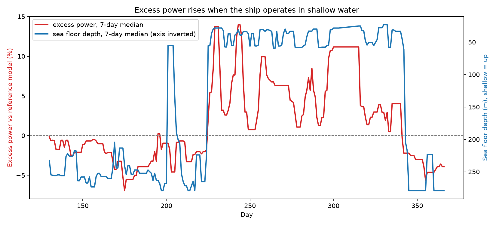
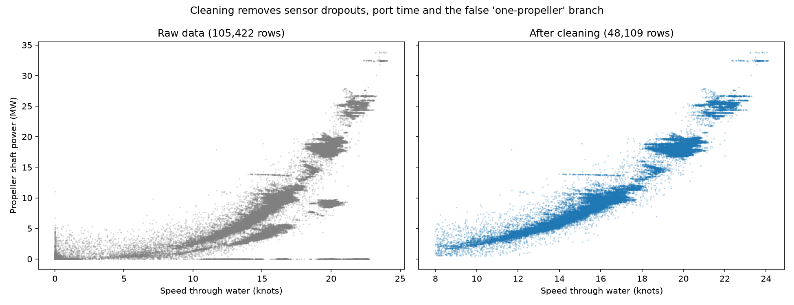
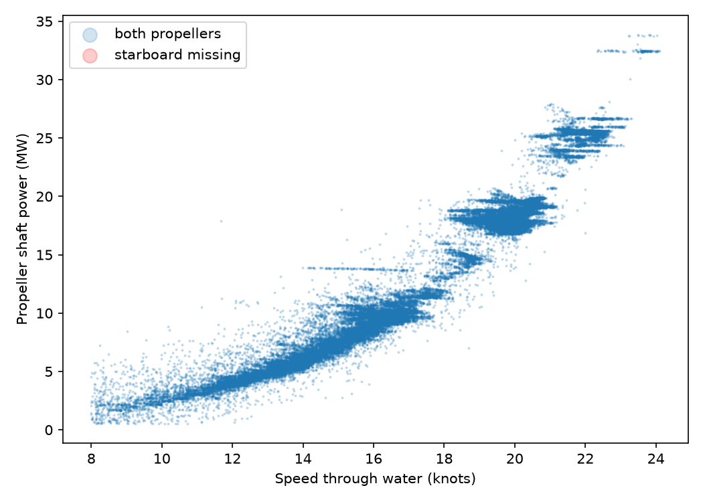
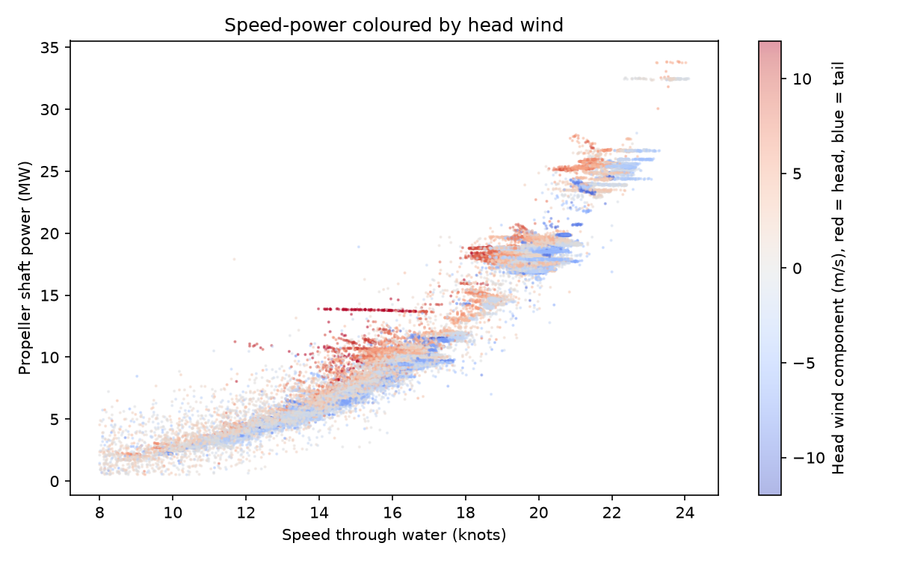
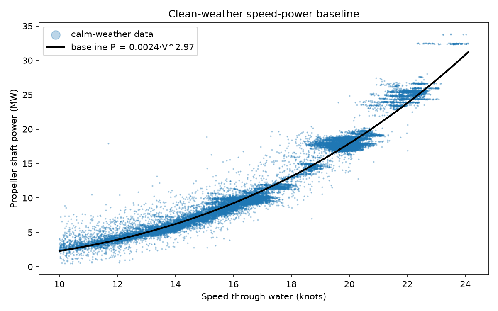
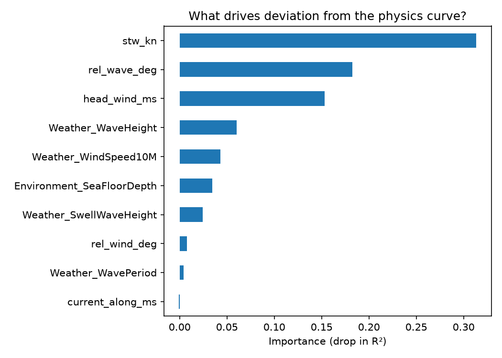
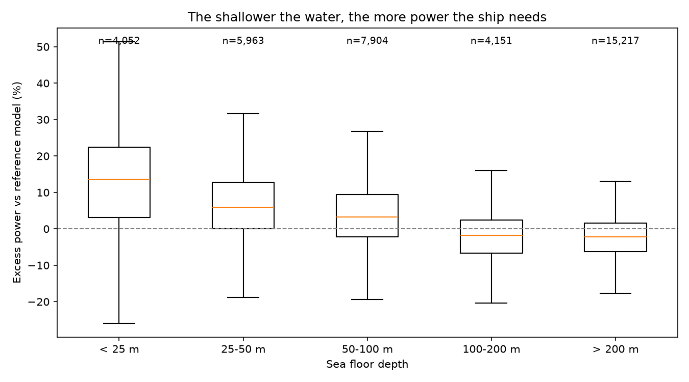
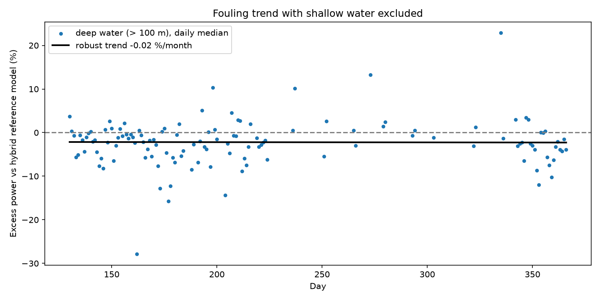
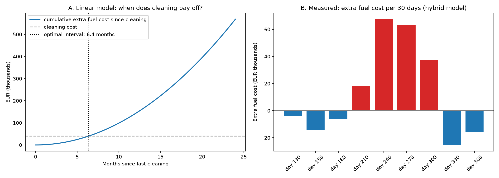

# Vessel Performance Analysis: Hull Fouling vs Shallow Water

Analysis of one year of high-frequency operational data from a large cruise ship, to estimate hull and propeller degradation and decide when a hull cleaning pays for itself.

**Author:** Dimitrios Atsidis, Computer Science, University of Crete



## Key findings

- **The apparent degradation was not fouling.** A first analysis showed about +0.6 % excess power per month (about 7 % per year), confirmed by two independent methods. Further checks showed this was mainly caused by **seasonal operation in shallow water**, not by the hull.
- **Deep-water fouling is small: between 0 and +0.3 % per month.** A hybrid physics-ML reference model shows no detectable trend (−0.02 %/month); the physics method gives an upper bound of +0.28 %/month.
- **Recommended cleaning interval: about 6 months or longer,** instead of the 4.4 months the first analysis suggested. This avoids unnecessary cleanings.
- **Shallow-water legs are the bigger cost:** up to about **€65,000 of extra fuel per 30 days** at peak. Speed planning in shallow areas may save more than extra hull cleaning.
- **A hybrid physics-ML model beats pure ML** for performance monitoring: similar accuracy, but it extrapolates correctly to high speeds (false-alarm days reduced from 24 to 5).

## Data

[FuelCast dataset](https://huggingface.co/datasets/krohnedigital/FuelCast) (Viga et al., 2025, [arXiv:2510.08217](https://arxiv.org/abs/2510.08217)), vessel **CPS Poseidon**: a 70,000 GT cruise ship with diesel-electric propulsion.

| Property | Value |
| --- | --- |
| Period | 12 months |
| Sampling | 5 minutes (105,422 rows, 65 columns) |
| Ship sensors | speed through water and over ground, shaft power per propeller, fuel per engine and boiler |
| Environment | wind, waves, swell, currents (Open-Meteo), sea floor depth (Copernicus Marine) |

The raw data is not included in this repository. Run `download_data.py` to fetch it, and see the dataset card for its license.

## Method

### 1. Data cleaning

| Rule | Reason | Rows removed |
| --- | --- | --- |
| Both propeller sensors present | `Propeller_Total_ShaftPower` treats a missing sensor as 0, creating a false "half-power" branch and zero-power rows while sailing | 20,645 |
| Steady sailing only (> 8 kn, > 0.5 MW) | Port time and manoeuvring | 36,668 |
| Frozen sensor runs | Speed log occasionally repeats identical values | small |

Result: **48,109 rows (45.6 %)** of clean steady-sailing data.



Three data-quality findings came out of this step:

1. **The "total" power column is unreliable.** Missing starboard data silently lowers it (verified below: the lower branch is exactly the rows with starboard missing).
2. **Horizontal streaks are not always sensor faults.** One streak of constant power with falling speed was traced to head seas (wind 8 → 13 m/s, waves 3.0 → 3.9 m, about 16° off the bow): a 14 % speed loss at constant power. These rows were kept.
3. **The speed log freezes occasionally,** repeating the same value to six decimals.



### 2. Weather features

Wind and wave directions were converted to angles relative to the ship's heading, plus a head-wind component and the current along the heading. The current direction convention was **validated against the ship's own sensors**: the current along track correlates with speed over ground minus speed through water (r = 0.62).



At the same speed, head wind needs about 10 % more power than tail wind.

### 3. Physics baseline (ISO 19030 approach)

A clean-weather speed-power curve P = a·Vⁿ was fitted on calm conditions only (|head wind| < 5 m/s, waves < 1.5 m):

**P = 0.00244 · V^2.97, R² = 0.973.** The exponent is almost exactly the theoretical cube law.



### 4. Hybrid physics-ML reference model

A gradient-boosting model was trained on the first 130 days (reference period) to learn how the ship performs in any weather, using a time-based split and no date feature, so that the model cannot learn degradation itself.

| Model | MAE (unseen days 130-160) | MAPE |
| --- | --- | --- |
| Physics P = a·Vⁿ | 0.78 MW | 8.7 % |
| Pure ML | 0.49 MW | 7.2 % |
| **Hybrid (physics × ML correction)** | **0.51 MW** | **7.3 %** |

The pure ML model produced **false alarms every 14 days**: one leg of the itinerary is sailed faster (up to 24.1 kn) than anything in the training data (max 21.1 kn), and tree models cannot extrapolate. In the hybrid model, physics handles speed and ML learns only the weather correction factor. Outlier days dropped from **24 to 5**.



With speed handled by physics, **relative wave direction and head wind** are the main drivers of deviation. Weather as a group explains 2.6 % of the variance in power: small next to speed, but it is the scatter that matters for monitoring.

### 5. Finding the confound: shallow water

All methods initially agreed on about +0.6 %/month. A closer look showed that excess power rose for about three months and then recovered, which a steadily fouling hull does not do. Checking against temperature, speed and depth:

| Days | Excess power | Median depth | Air temperature |
| --- | --- | --- | --- |
| 120-180 | −1 to −2 % | 244-256 m | 22-24 °C |
| 210-300 | **+2 to +7 %** | **34-71 m** | 27-28 °C |
| 330-360 | −2 to −4 % | 179-279 m | 27-28 °C |

Temperature stays high after the hump, so it does not explain the recovery. Depth does: the ship spent that season in shallow coastal water, where squeezed flow under the hull raises resistance. The reference period contained almost no shallow water (median 270 m), so neither model could learn the effect.



| Sea floor depth | Median excess power | Rows |
| --- | --- | --- |
| < 25 m | **+13.6 %** | 4,052 |
| 25-50 m | +5.8 % | 5,963 |
| 50-100 m | +3.2 % | 7,904 |
| 100-200 m | −1.8 % | 4,151 |
| > 200 m | −2.2 % | 15,217 |

Excess power rises steadily as the water gets shallower and levels off below about 100 m depth, which is why 100 m was used as the deep-water filter.

**Lesson:** two methods agreeing is only convincing if they do not share the same blind spot. Both lacked a shallow-water filter.

### 6. Fouling trend in deep water only (> 100 m)

| Trend per 30 days | All water | Deep water only |
| --- | --- | --- |
| Hybrid model | +0.57 % | **−0.02 %** |
| Physics + calm filter | +0.59 % | **+0.28 %** (upper bound) |



### 7. Business case

| Input | Value | Source |
| --- | --- | --- |
| Specific fuel consumption | 210 g/kWh | ship's own generator fuel and power data |
| Fuel mix burned | 66 % RM 380, 34 % DM, 1 % RM 180 | ship data |
| CO2 factor | 3.145 t CO2 per t fuel | IMO factors weighted by fuel mix |
| Cost of 1 % extra propulsion power | 11.7 t fuel ≈ €7,050 per month | at €600/t (assumed) |
| Cleaning cost | €40,000 | assumed |

With fouling growing linearly, the optimal cleaning interval is T = √(2 × cleaning cost / k), where k is the monthly growth in extra fuel cost. At the deep-water upper bound of +0.28 %/month:

| Cleaning cost | €20k | €40k | €80k |
| --- | --- | --- | --- |
| Optimal interval | 4.5 months | **6.4 months** | 9.0 months |

**Measured extra fuel from shallow-water operation** (hybrid model, days 130-365): about **201 t of fuel, €120,000 and 631 t CO2**, with a peak of about €67,000 in one 30-day period.



## Limitations

- **One year of data.** Fouling below about 0.3 %/month cannot be ruled out, especially because days 230-340 contain few deep-water days.
- **No draft data.** Cruise ships keep a fairly constant draft, so this matters less than for a tanker or bulk carrier.
- **Hourly weather,** interpolated to 5 minutes; no water temperature.
- **Reference period is not a freshly cleaned hull.** Measured excess is relative to days 0-130.
- **Shallow-water legs** (< 30 m) lie outside the reference data; a dedicated shallow-water correction would be the next step.
- **Cost inputs** (fuel price, cleaning cost, electric efficiency) are assumptions and are stated in `src/business_case.py`.

## Project structure

```
vessel-performance-analysis/
├── download_data.py        # fetch the FuelCast dataset
├── notes.md                # working notes and data-quality findings
├── src/
│   ├── explore.py          # first look at the data
│   ├── clean.py            # cleaning rules
│   ├── features.py         # weather relative to the ship, current validation
│   ├── baseline.py         # calm-weather speed-power baseline and trend
│   ├── model.py            # pure ML vs hybrid physics-ML reference model
│   ├── check_depth.py      # shallow-water confound and deep-water trend
│   ├── business_case.py    # fuel, cost, CO2, cleaning interval, sensitivity
│   └── report_figures.py   # extra figures for this README
└── outputs/figures/        # all figures
```

## How to run

```bash
python -m venv .venv
source .venv/bin/activate
pip install huggingface_hub pandas pyarrow matplotlib numpy scikit-learn

python download_data.py
python src/clean.py
python src/features.py
python src/baseline.py
python src/model.py
python src/check_depth.py
python src/business_case.py
python src/report_figures.py
```

Each script reads the previous step's output from `data/processed/` and saves its figures to `outputs/figures/`.

## Tools

Python, pandas, NumPy, scikit-learn (HistGradientBoostingRegressor, HuberRegressor, permutation importance), matplotlib.